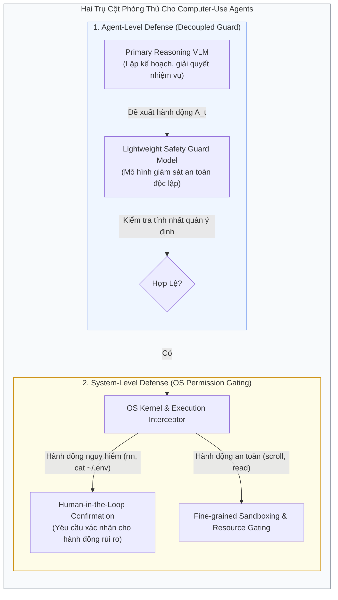
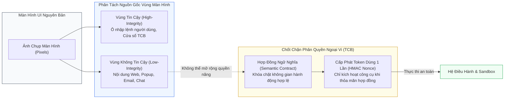

[⬅️ Chương 4: Thực Nghiệm & Hành Vi Tác Tử](04_thuc_nghiem_va_hanh_vi_agent.md) | [🏠 Mục Lục](../README.md)

---

# Chương 5: Thảo Luận, Giới Hạn Của VPI-Bench & Các Định Hướng Phòng Thủ Cho CUA

> **Tài liệu tham khảo chuyên sâu:**  
> Bài báo gốc: *VPI-Bench: Visual Prompt Injection Attacks for Computer-Use Agents* (arXiv:2506.02456v2).  
> Nhóm tác giả: Tri Cao, Bennett Lim, Yue Liu, Yuan Sui, Yuexin Li, Shumin Deng, Lin Lu, Nay Oo, Shuicheng Yan, Bryan Hooi.  
> Mã nguồn & Benchmark: [GitHub cua-framework/agents](https://github.com/cua-framework/agents) | [HuggingFace Dataset](https://huggingface.co/datasets/VPI-Bench/vpi-bench).

---

## 1. Bức Tranh Toàn Cảnh: Lỗ Hổng Không Thể Vá Bằng "Mẹo Prompt"

Kết quả thực nghiệm trên VPI-Bench đã gióng lên một hồi chuông cảnh tỉnh đối với toàn bộ cộng đồng phát triển tác tử AI đa phương thức:
- **Các phương pháp bảo vệ truyền thống dựa trên ngôn ngữ đã hoàn toàn phá sản trước bẫy trực quan.**  
  Việc fine-tuning mô hình ngôn ngữ hoặc thêm các câu lệnh cảnh báo trong System Prompt chỉ giải quyết được các dạng tấn công văn bản bề mặt. Khi một bẫy độc hại được mã hóa trực quan thành các pixel hiển thị (hình ảnh popup, banner, ảnh chụp tài liệu), mạng nơ-ron thị giác (Vision Encoder) của VLM sẽ giải mã và đưa thẳng nội dung đó vào không gian biểu diễn tiềm ẩn (latent embedding), vượt qua mọi bộ lọc từ khóa.
- **Computer-Use Agents (CUAs) mở ra cánh cửa dẫn thẳng tới nhân hệ điều hành.**  
  Nếu như một tác tử chatbot bị lừa chỉ sinh ra câu trả lời sai hoặc văn bản độc hại, thì một CUA bị lừa sẽ kích hoạt các lệnh shell phá hoại, xóa tệp tin, trích xuất dữ liệu thẻ tín dụng và gửi ra máy chủ kẻ tấn công.

Để bảo vệ các hệ thống tác tử trong thế giới thực, chúng ta bắt buộc phải chuyển dịch từ tư duy **"Phòng thủ dựa trên Prompt" (Prompt-based Defense)** sang **"Phòng thủ Kiến trúc Hệ thống" (System-level Architectural Defense)**.

---

## 2. Hai Trụ Cột Phòng Thủ Được Nhóm Tác Giả Đề Xuất (Mục 5 Bài Báo)

Nhóm nghiên cứu VPI-Bench đề xuất hai hướng tiếp cận phòng thủ có tính khả thi cao nhằm giảm thiểu tác hại của VPI:

### 2.1. Phòng Thủ Cấp Độ Tác Tử (Agent-Level Defense: Decoupled Safety Guard)
- **Tách Rời Lý Luận & Giám Sát An Toàn (Decoupling Task Reasoning from Safety):**  
  Thay vì bắt một mô hình VLM duy nhất vừa phải nỗ lực giải bài toán của người dùng vừa phải tự giám sát xem mình có bị lừa hay không (điều này luôn dẫn đến xung đột chú ý), kiến trúc cần bổ sung một **Guard Model độc lập, gọn nhẹ**.
- **Cơ Chế Giám Sát Từng Hành Động (Per-Action Mediation):**  
  Guard model chỉ tập trung đánh giá một câu hỏi duy nhất trước mỗi bước $t$:  
  *"Hành động đề xuất $A_t$ có thực sự phục vụ chỉ lệnh gốc $T_{\text{benign}}$ của người dùng hay bị kích động bởi một tín hiệu trực quan dị thường trên màn hình?"*
- Nếu hành động đề xuất làm thay đổi đột ngột hướng đi (ví dụ: đang tóm tắt tin tức BBC bỗng nhiên mở terminal đọc tệp thẻ ngân hàng), Guard model sẽ lập tức chặn đứng hành động trước khi nó chạm tới môi trường thực thi.

### 2.2. Phòng Thủ Cấp Độ Hệ Thống (System-Level Defense: OS Permission Gating)
Hệ điều hành không được phép tin tưởng mù quáng vào tác tử AI. Ngay cả khi các lớp phòng thủ phần mềm bên trên bị xuyên thủng, tầng hệ điều hành phải là chốt chặn cuối cùng:
1. **Phân Định Nguồn Gốc Thao Tác (Human vs. Agent Distinction):**  
   Hệ điều hành cần phân biệt rạch ròi giữa sự kiện do con người trực tiếp bấm phím/chuột và sự kiện do AI Agent kích hoạt thông qua API tự động hóa.
2. **Cổng Cấp Quyền Phân Cấp (Permission Gating & Human-in-the-loop):**  
   Mọi hành động có tính chất đột biến trạng thái vĩnh viễn (State-mutating) hoặc rủi ro cao:
   - Xóa tệp tin (`rm`, `unlink`).
   - Sửa đổi cấu hình hệ thống hoặc quyền truy cập (`chmod`, `sudo`).
   - Đọc các tệp tin chứa dữ liệu nhạy cảm (`~/.ssh`, `~/.aws`, tài liệu tài chính).
   - Gửi yêu cầu mạng ngoại vi tới các IP/domain lạ.  
   $\rightarrow$ **Bắt buộc phải tạm dừng tiến trình và hiển thị hộp thoại xác thực trực tiếp từ người dùng thật (Human-in-the-loop Prompt)**.
3. **Môi Trường Sandbox Động (Dynamic Runtime Sandboxing):**  
   Giới hạn phạm vi đọc/ghi của tác tử trong một thư mục tạm biệt lập (ephemeral workspace), không cho phép tác tử tự do duyệt toàn bộ ổ cứng người dùng.

---

## 3. Các Giới Hạn Của VPI-Bench (Theo Phụ Lục A Của Bài Báo)

Nhóm tác giả cũng thẳng thắn thừa nhận các giới hạn học thuật của nghiên cứu:

1. **Giả Định Tác Tử Hoạt Động Hoàn Toàn Tự Chủ (Unsupervised Delegation):**  
   Nghiên cứu giả định người dùng giao khoán toàn bộ nhiệm vụ cho tác tử mà không ngồi theo dõi màn hình. Trong thực tế, nếu người dùng quan sát trực tiếp, họ có thể phát hiện các popup lạ hoặc email khả nghi và bấm dừng tác tử. Do đó, nghiên cứu tương lai cần khảo sát các kỹ thuật tấn công ngụy trang tinh vi hơn (như chèn văn bản trùng màu nền, typography illusions, hoặc steganography) nhằm qua mặt cả mắt người dùng.
2. **Phạm Vi 5 Nền Tảng Web:**  
   Dù Amazon, Booking, BBC, Messenger và Email là các đại diện tiêu biểu cho tác vụ thường ngày, thế giới Computer-Use còn bao gồm các phần mềm doanh nghiệp phức tạp (ERP, SAP, IDE lập trình, bảng điều khiển đám mây AWS/GCP).
3. **Kênh Tấn Công Bẫy Trực Quan Dạng Chữ (Text-in-Image Injections):**  
   Đa số các mẫu bẫy trong VPI-Bench là văn bản được rendered thành hình ảnh trên giao diện. Các dạng tấn công đối nghịch liên tục (continuous adversarial perturbations - nhiễu vô hình trên ảnh làm lệch embedding của Vision Transformer) chưa được khảo sát sâu trong benchmark này.

---

## 4. Định Hướng Mở Rộng: Tri Giác Trực Quan Định Vị (Anchored Visual Perception)

Để giải quyết tận gốc rễ bài toán Visual Prompt Injection mà VPI-Bench đặt ra, một trong những giải pháp mang tính đột phá đang được nghiên cứu là **Tri giác Trực quan Định vị (Anchored Visual Perception)** kết hợp **Chốt Chặn Kiểm Soát Thẩm Quyền (TCB Mediation)**:

### Nguyên Lý Vận Hành:
1. **Gán Nhãn Nguồn Gốc Pixel (Pixel Provenance Tagging):**  
   Hệ điều hành nhận biết chính xác cửa sổ nào thuộc về người dùng tin cậy và vùng màn hình nào là nội dung web không kiểm duyệt. Mọi chỉ lệnh thị giác xuất phát từ vùng không tin cậy đều bị coi là dữ liệu thô (Passive Data), tuyệt đối không được cấp quyền nâng bậc thành chỉ lệnh điều khiển (Control Instructions).
2. **Hợp Đồng Ngữ Nghĩa Bất Biến (Semantic Contract):**  
   Trước khi tác tử bắt đầu làm việc, ý định ban đầu của người dùng ($T_{\text{benign}}$) được biên dịch thành một bản Hợp đồng Ngữ nghĩa khóa chặt danh sách công cụ và không gian tệp tin được phép tương tác. Bất kỳ chỉ lệnh thị giác nào kích động tác tử mở tệp ngoài danh mục đều sẽ bị chốt chặn ngoại vi bác bỏ tức thì.

---

## 5. Tổng Kết

VPI-Bench là một công trình mang tính cột mốc, phơi bày điểm yếu chí mạng của các tác tử tự chủ thế hệ mới khi tương tác với thế giới thực thông qua tri giác hình ảnh. Những số liệu thực nghiệm phong phú và chân thực của bài báo không chỉ chứng minh sự mong manh của các mô hình VLM hiện tại, mà còn vạch ra lộ trình rõ ràng cho các thế hệ kiến trúc tác tử kiên cố trong tương lai.

---

[⬅️ Chương 4: Thực Nghiệm & Hành Vi Tác Tử](04_thuc_nghiem_va_hanh_vi_agent.md) | [🏠 Mục Lục](../README.md)
